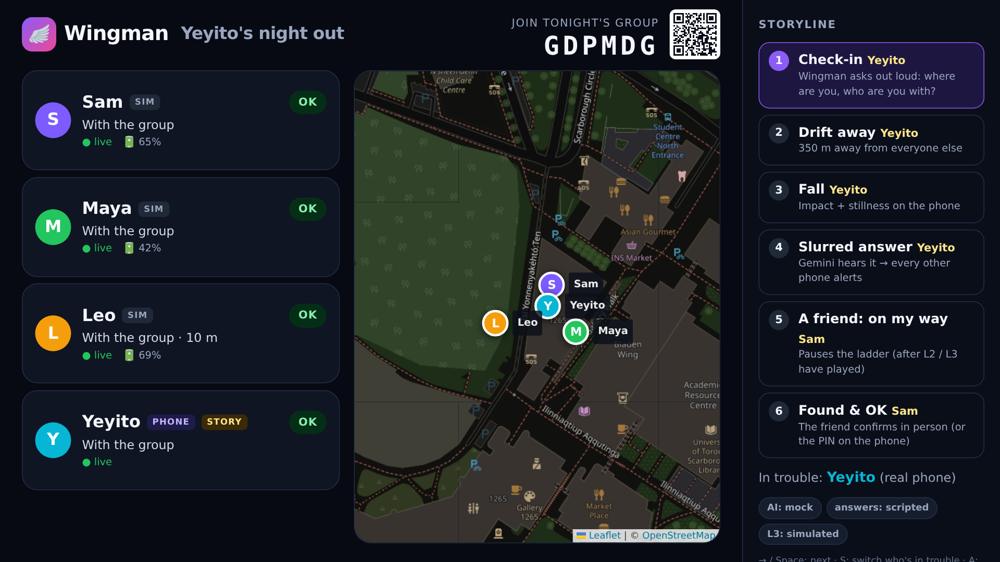
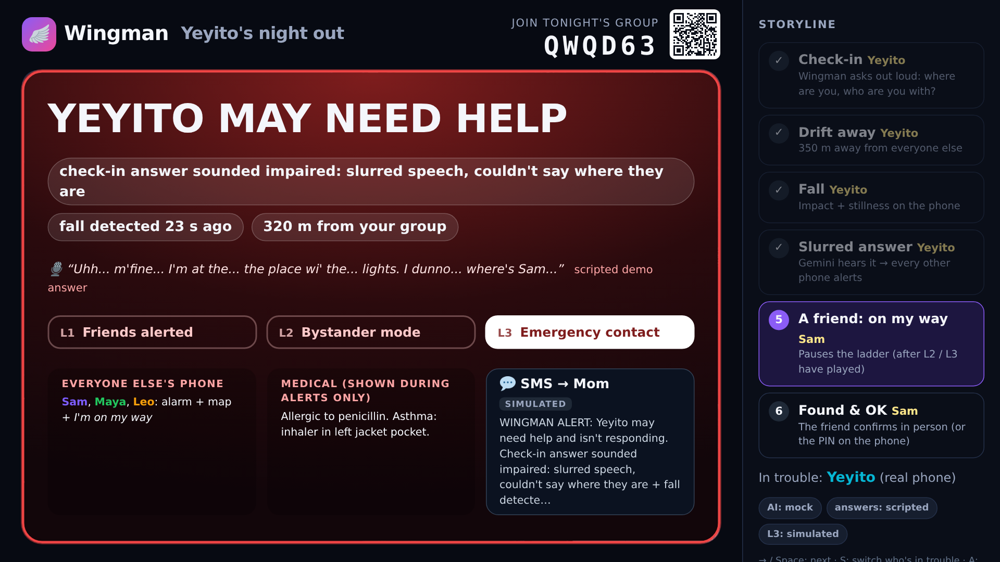
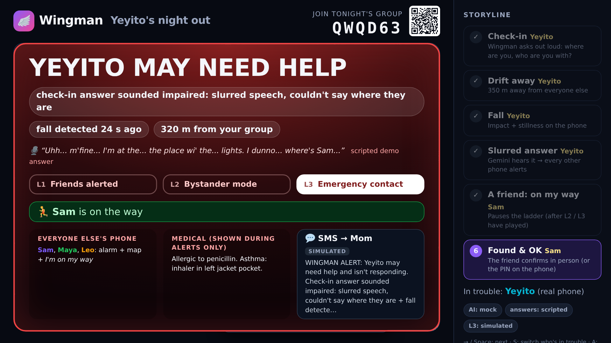
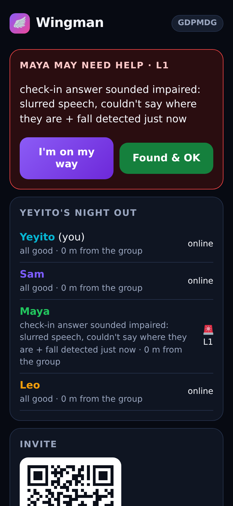

# 🪽 Wingman

**An AI night-out guardian for your whole group. Nobody needs to press SOS.**

Built at Hack the Valley 11 (UTSC) for the **Project KAZE** challenge: *how might we help people stay safe and get
assistance when they are no longer in a position to ask for help themselves?*

When a drink is spiked, or someone is badly intoxicated or collapses, they can't unlock a phone, make a call or press a
panic button. Wingman closes the gap between *"I can't protect myself anymore"* and *"someone realizes I need help"*.
**Everyone is everyone's wingman:** a group of friends all run Wingman, each phone watches its owner's passive
signals and runs short AI voice check-ins, and when one of them looks to be in trouble, **every other phone in the
group** is alerted. If nobody responds, the person's own phone asks bystanders for help, and then their emergency
contact is texted.

| Stage view: the group | Alarm takeover (L3) | Friend acknowledged | Web fallback: a friend's alert |
|---|---|---|---|
|  |  |  |  |

## What it does

1. **A group for tonight.** One friend starts a group and gets a 6-letter join code (`K7Q2XM`), a QR code and a link
   (`wingman://join/K7Q2XM`, `https://<host>/j/K7Q2XM`). Everyone who joins sets a PIN, optional medical info and an
   emergency contact, and consents to being guarded **and** to guarding the others. No accounts.
2. **Every member is symmetric.** Each phone (native iPhone app, `mobile/`) sends its own signals, and each member has
   their own risk engine and escalation ladder on the server:
   - **Fall detection** (impact over ~2.6 g, then stillness) and motion summaries;
   - **Distance from the group**: to the *nearest other member* with a fresh fix, minus GPS uncertainty;
   - **Dead-man's switch**: heartbeats every 5 s. A phone that dies or is taken goes "silent". A phone that reports
     going to the background or being locked first doesn't count;
   - battery, app state, an untouched phone, prolonged stillness.
3. **AI voice check-ins.** On a cadence (every 30 min), when the risk engine gets suspicious, or when a friend taps
   *ping*, the phone **speaks** a question ("Where are you right now, and who are you with?") and records the reply
   (iOS `.m4a`). **Gemini listens to the audio** and scores coherence, slurring and confusion with a short reason a
   friend can understand.
4. **Risk engine.** A pure, deterministic, unit-tested function combines the signals into a 0–100 score with
   readable reasons, e.g. *"check-in answer sounded impaired: slurred speech + fall detected 2 min ago + 310 m from your
   group"*.
5. **Escalation ladder per member** (several members can be in alert at once):
   - **L1 Everyone else:** every other member's phone alarms, with the map, reasons, *I'm on my way* and *Found & OK*.
     Acks are visible to the whole group and pause the ladder.
   - **L2 Bystander mode** on the affected member's phone: siren, **"THIS PERSON MAY NEED HELP"**, medical info,
     *Call 911*, and *I'm OK* that needs **their PIN** (3 wrong tries lock it for 30 s).
   - **L3 Emergency contact:** SMS (optionally a voice call) via **Twilio**, clearly **simulated** without credentials.
   - **De-escalation:** a coherent check-in, the member's PIN, or any friend confirming *found & OK* in person.
6. **Privacy by design:** opt-in per person per night; location shared with the group (or only on alert); medical
   info and the contact's number revealed to friends **only during your alert**; **everything in memory, deleted when
   the night ends** (any member can end it) or after 12 h. Leaving deletes your data. Voice replies are scored and
   discarded.
7. **Demo mode** for presenting: simulated friends (Sam, Maya, Leo) who move, heartbeat and answer check-ins;
   accelerated timers; a projector **stage view** whose storyline advances with a clicker (or clickable steps and
   **Next ▶** in a slim presenter dock; **D** shows presenter details), with either the real phone or a simulated
   friend as the one in trouble. The same storyline runs as an automated test.

## Run it

```bash
bun install && bun run dev          # http://localhost:3000
secrets run --allow GEMINI_API_KEY -- bun run dev     # with the Gemini key (never put keys in the repo)
bun run tunnel                      # https://*.trycloudflare.com URL for phones
```

- **iPhone app:** see `mobile/` (Expo). Point it at the server URL.
- **Wire protocol** (for the app and anyone else): [`shared/protocol.ts`](shared/protocol.ts) and
  [`docs/PROTOCOL.md`](docs/PROTOCOL.md): REST + WebSocket, per-member Bearer keys.
- **Presenting:** open `/` on the laptop → **Create a stage demo** → join the code from the phone. See
  [DEMO.md](DEMO.md).
- **Web fallback:** `/g/<CODE>` is a minimal browser client (join, alerts, ack / found & OK, PIN, typed check-ins).
- Deploying to a VPS (Vultr) with Docker + Caddy HTTPS: see [DEPLOY.md](DEPLOY.md).

## Environment variables

All optional. With none set, Wingman runs fully offline with a deterministic mock scorer and a simulated notifier.

| Variable | Purpose |
|---|---|
| `PORT` | HTTP port (default 3000) |
| `PUBLIC_URL` | Base URL for share links and SMS (auto-detected from the request otherwise; works through tunnels) |
| `GEMINI_API_KEY` | **Primary AI scorer.** The voice reply goes to Gemini as audio |
| `GEMINI_MODEL` | Override; default tries `gemini-flash-lite-latest` (~2 s), then `gemini-flash-latest`, then `gemini-3.5-flash` |
| `OPENAI_API_KEY` | Fallback scorer: transcription (`gpt-4o-mini-transcribe`) + `gpt-4o-mini` |
| `OPENAI_MODEL`, `OPENAI_TRANSCRIBE_MODEL` | Overrides for the fallback |
| `SCORER` | Force `gemini` / `openai` / `mock` first |
| `TWILIO_ACCOUNT_SID`, `TWILIO_AUTH_TOKEN`, `TWILIO_FROM_NUMBER` | Real SMS at level 3 |
| `TWILIO_VOICE=true` | Also place a text-to-speech voice call |
| `EXPO_PUSH=1` | Send alert/check-in pushes to backgrounded members with an Expo push token (public Expo push API; `EXPO_ACCESS_TOKEN` optional). Off by default: tokens are stored, nothing is sent |

The scorer degrades gracefully. On an error, rate limit (429), overload (5xx) or a 20 s timeout it tries the next Gemini
model, then OpenAI, then the mock, so a check-in always gets scored. Results are cached by content hash, so a replayed
demo clip doesn't spend quota.

## Architecture

```
 iPhone app (Expo) × N members             Stage view (projector)        Web fallback
 ┌──────────────────────────────┐          ┌────────────────────────┐    ┌──────────────┐
 │ location · motion/fall ·     │          │ member cards + map,    │    │ join, alerts,│
 │ heartbeat · app state ·      │          │ alarm takeover, clicker│    │ ack, PIN     │
 │ battery · voice check-ins    │          │ storyline dock         │    └──────┬───────┘
 │ alerts: on my way / found OK │          └──────────┬─────────────┘           │
 └──────┬──────────────▲────────┘                     │ WS (observer)           │
  REST signals/answers │ WS hello/view/alert/checkin  │ POST /demo/*            │
 ┌──────▼──────────────┴──────────────────────────────▼─────────────────────────▼──────────┐
 │ Bun server (TypeScript, in-memory, no DB)                                                 │
 │  Group ── per member: signals ─► riskInput ─► assessRisk() [pure] ─► escalation.step()    │
 │                       distance = nearest other member                [pure state machine] │
 │  effects: probe check-in (to that member) · alert fan-out (to every OTHER member + push)  │
 │           bystander (that member's phone) · L3 notifier (Twilio | simulated)              │
 │  scorer: Gemini (audio in) ─► OpenAI ─► offline heuristic · 250 ms tick · privacy views   │
 └───────────────────────────────────────────────────────────────────────────────────────────┘
```

| Path | What |
|---|---|
| `shared/protocol.ts` | Wire protocol: REST/WS types, view model (imported by server, stage view and the iPhone app) |
| `src/server/risk.ts` | Pure risk engine (weights, thresholds, reasons) |
| `src/server/escalation.ts` | Pure per-member escalation state machine |
| `src/server/group.ts` | Group + members: signals, check-ins, distances, fan-out effects, privacy-filtered views |
| `src/server/app.ts` | HTTP API, WebSocket, join pages, demo actions, tick loop |
| `src/server/scorer.ts` | Gemini / OpenAI / mock check-in scoring with fallback + cache (m4a/AAC normalised) |
| `src/server/notifier.ts`, `push.ts` | Twilio SMS/voice or simulated; optional Expo push |
| `src/client/stage.ts`, `map.ts` | Projector stage view |
| `src/client/web.ts` | Minimal web fallback |
| `src/shared/story.ts` | The stage storyline (shared by the stage view, rehearsal and tests) |
| `public/demo-audio/` | Canned voice replies for the demo, **generated with Gemini TTS** (`scripts/make-demo-audio.ts`) |

Risk weights (`src/server/risk.ts`): fall 30 · missed check-in 35 (two or more: 60) · impaired check-in 20–60
(scaled by the model's impairment score) · ≥300 m from group 25 (≥150 m: 12) · left venue 10 · phone silent 30 ·
stillness 15 · untouched 10 · 1–6 AM +10. **Watch ≥ 25** triggers an extra check-in; **alert ≥ 60** starts the
ladder. A coherent check-in clears earlier signals, so the same drift isn't flagged twice.

## Tests

```bash
bun test                 # unit (risk engine, escalation) + end-to-end group storyline over HTTP/WS, ~5 s, no network
bun run screenshots      # drives the stage view + web fallback in headless Chromium; fails on JS errors, overflow or occlusion
bun scripts/stage-shots.ts /tmp/shots   # stage with the phone at UofT St. George, driven by clicking the dock (PHONE_ACC=1500: coarse fix)
bun run rehearse         # dress rehearsal: the stage storyline at real pitch pace (~95 s) with timeline checks
E2E_LIVE_AI=1 secrets run --allow GEMINI_API_KEY -- bun test tests/e2e.test.ts   # +1 real Gemini call with an iOS .m4a
```

The end-to-end test starts a real server with **three members connected over WebSocket**, plays drift → fall →
slurred answer → L1 (asserts every *other* member got the alert) → L2 bystander → L3 SMS → a friend's ack → wrong PIN
rejected → another friend's *found & OK* → end night deletes everything, and asserts the stage sequence `[0, 1, 2, 3,
0]` and the event-log order. Other tests cover concurrent alerts, m4a answers (base64 JSON and raw), a friend's ping,
privacy filtering, auth, leaving, the dead-man's switch vs. backgrounding, and a demo group with simulated friends where
either the real phone or a friend is in trouble.

## Honest limitations

- iOS limits background execution. The app reports background/locked before going quiet so that isn't an alarm, and
  alerts reach backgrounded friends as notifications only when push is configured.
- The fall detector is a threshold heuristic tuned for demos, not a medically validated classifier.
- Voice impairment scoring is an LLM judgment: a *signal*, never a diagnosis. That's why it feeds a risk score and a
  human (a friend) is always the first responder.
- Groups live in memory: restarting the server ends them (by design, nothing is persisted).
