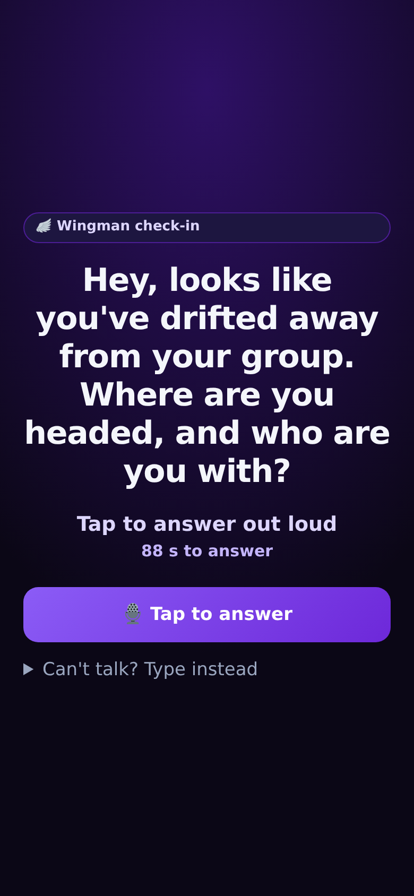
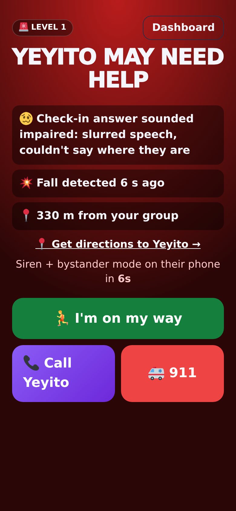
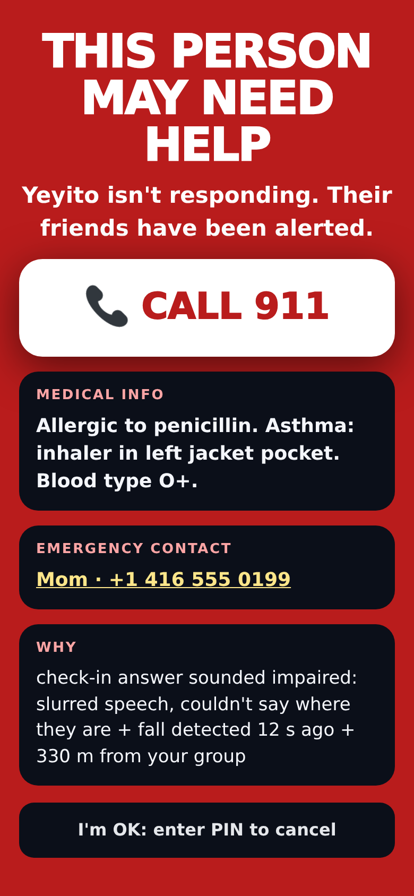
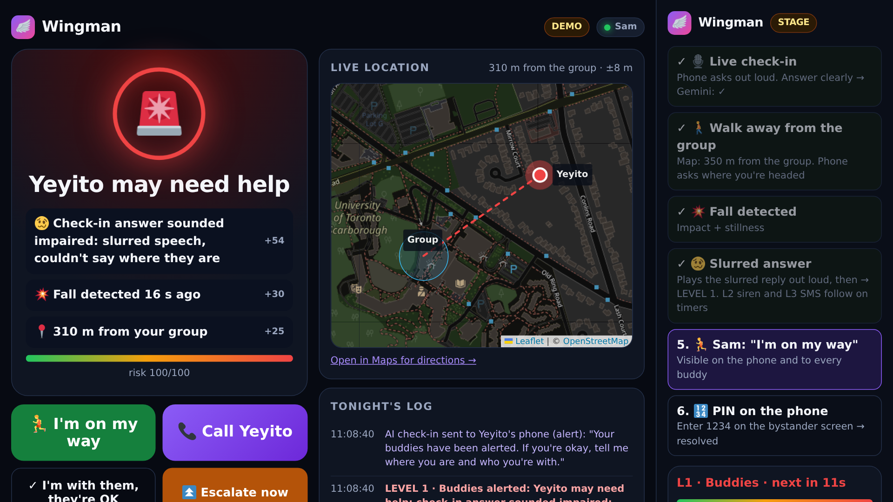

# 🪽 Wingman

**An AI night-out guardian that never needs you to press SOS.**

Built at Hack the Valley 11 (UTSC) for the **Project KAZE** challenge: *how might we help people stay safe and get
assistance when they are no longer in a position to ask for help themselves?*

When a drink is spiked, or someone is badly intoxicated or collapses, they can't unlock a phone, make a call or
press a panic button. Wingman closes the gap between *"I can't protect myself anymore"* and *"someone realizes I need
help"*. It watches passive signals from the phone and runs short AI voice check-ins. When things look wrong, it walks up
an escalation ladder (buddies → bystanders → emergency contact) without the person doing anything.

| Phone: check-in | Buddy: alert | Phone: bystander mode | Stage view (projector) |
|---|---|---|---|
|  |  |  |  |

## What it does

1. **Night-out session.** The person opts in for tonight, sets a PIN, adds medical info and an emergency contact, and
   shares a link (or QR code) with 1–3 buddies. Buddies open it on any phone. There's no app store and no account.
2. **Passive signals** from the phone browser:
   - **Fall detection** via DeviceMotion: an impact over 2.6 g followed by stillness. Ordinary movement keeps a
     "last moved" signal fresh.
   - **Live location** via Geolocation: distance from the group (buddies' live positions, or the venue). Position
     uncertainty is subtracted so indoor GPS jitter can't raise a false alarm.
   - **Dead-man's switch**: heartbeats every 5 s. A phone that dies or is taken goes "silent"; a phone that is merely
     locked tells the server first, so that doesn't count.
   - Phone untouched for a long time, and prolonged stillness.
3. **AI voice check-ins.** On a cadence (every 30 min) and whenever the risk engine gets suspicious, the phone chimes,
   vibrates and **speaks** a question ("Where are you right now, and who are you with?"). It records the spoken reply,
   then **Gemini listens to the audio** and scores coherence, slurring and confusion with a short reason a friend can
   understand. No answer means a missed check-in.
4. **Risk engine.** A pure, deterministic, unit-tested function combines the signals into a 0–100 score and
   human-readable reasons, e.g. *"check-in answer sounded impaired: slurred speech + fall detected 2 min ago + 310 m from
   your group"*.
5. **Escalation ladder** with configurable timers:
   - **L1 Buddies:** the buddy dashboard takes over the screen with an alarm, vibration, live map, reasons, and
     *I'm on my way* / *Call* / *911* buttons. Acknowledgements are visible to everyone and pause the ladder.
   - **L2 Bystander mode:** the person's phone flashes **"THIS PERSON MAY NEED HELP"** with a siren, their medical
     info, a giant *Call 911* button, and an *I'm OK* that needs **their PIN**. A confused person can't dismiss it by
     accident, and wrong PINs lock out after 3 tries.
   - **L3 Emergency contact:** SMS (and optionally a voice call) via **Twilio** with the reasons and a map link.
     Without Twilio credentials it is clearly **simulated** and shown in the UI.
   - **De-escalation:** a coherent check-in, the PIN, or a buddy confirming in person resolves the alert.
     Everything goes to an event log the buddies see.
6. **Privacy by design:** opt-in per night, location visible only during the session (or only on alert, the person's
   choice), medical info revealed to buddies only during an alert, **everything kept in memory and deleted when the
   night ends** (or after 12 h). Voice replies are scored and discarded, never stored.
7. **Demo mode** for presenting: accelerated timers, a control panel, and a **stage view** (buddy dashboard for the
   projector plus a storyline you advance with a presentation clicker). The same storyline runs as an automated test.

## Run it

```bash
bun install && bun run dev          # http://localhost:3000
```

Phones need **HTTPS** for motion, location and the microphone. In a second terminal:

```bash
bun run tunnel                      # downloads cloudflared into tools/ and prints an https://*.trycloudflare.com URL
```

Open the tunnel URL on your phone. Alternatives: `npx localtunnel --port 3000` or `ngrok http 3000`.

With the Gemini key from the secrets store (never put keys in the repo):

```bash
secrets run --allow GEMINI_API_KEY -- bun run dev
# or copy .env.example to .env and fill it in (Bun loads .env automatically)
```

**Presenting:** open `/` on a laptop, click **Create a stage demo**, scan the phone QR code with your phone, and press
**Open stage view**. See [DEMO.md](DEMO.md).

Deploying to a VPS (Vultr) with Docker + Caddy HTTPS: see [DEPLOY.md](DEPLOY.md).

## Environment variables

All optional. With none set, Wingman runs fully offline with a deterministic mock scorer and a simulated notifier.

| Variable | Purpose |
|---|---|
| `PORT` | HTTP port (default 3000) |
| `PUBLIC_URL` | Base URL for share links and SMS (auto-detected from the request otherwise; works through tunnels) |
| `GEMINI_API_KEY` | **Primary AI scorer.** The voice reply goes to Gemini as audio |
| `GEMINI_MODEL` | Override; default tries `gemini-flash-lite-latest` (~2 s), then `gemini-flash-latest`, then `gemini-3.5-flash` |
| `OPENAI_API_KEY` | Fallback scorer: transcription (`gpt-4o-mini-transcribe`) + `gpt-4o-mini` |
| `OPENAI_MODEL`, `OPENAI_TRANSCRIBE_MODEL` | Overrides for the fallback |
| `SCORER` | Force `gemini` / `openai` / `mock` first |
| `TWILIO_ACCOUNT_SID`, `TWILIO_AUTH_TOKEN`, `TWILIO_FROM_NUMBER` | Real SMS at level 3 |
| `TWILIO_VOICE=true` | Also place a text-to-speech voice call |

The scorer degrades gracefully. On an error, rate limit (429), overload (5xx) or a 20 s timeout it tries the next Gemini
model, then OpenAI, then the mock, so a check-in always gets scored. Results are cached by content hash, so a replayed
demo clip doesn't spend quota.

## Architecture

```
 Person's phone (PWA, browser)                     Buddies' phones / laptop          Demo panel / stage view
 ┌───────────────────────────────┐                 ┌─────────────────────────┐       ┌───────────────────────┐
 │ DeviceMotion → fall detector  │                 │ live status + reasons   │       │ storyline buttons /   │
 │ Geolocation (watchPosition)   │                 │ Leaflet map (OSM)       │       │ clicker keys, timers, │
 │ touches, battery, wake lock   │                 │ alarm takeover, ack,    │       │ engine state, log     │
 │ check-in: chime → speak →     │                 │ call, escalate, log     │       └──────────┬────────────┘
 │   MediaRecorder → 16 kHz WAV  │                 └──────────▲──────────────┘                  │
 │ bystander mode: siren + PIN   │                            │ WebSocket (role-filtered views) │ POST /demo/*
 └──────────┬───────────▲────────┘                            │                                 │
   POST signals / audio │ WebSocket push                      │                                 │
 ┌──────────▼───────────┴─────────────────────────────────────┴─────────────────────────────────▼──────────┐
 │ Bun server (TypeScript, in-memory, no DB)                                                                │
 │                                                                                                          │
 │  Session ──► riskInput(now) ──► assessRisk()  [pure, unit-tested] ──► score, level, readable reasons     │
 │     ▲                                   │                                                                │
 │     │ signals, check-ins,               ▼                                                                │
 │     │ acks, PIN              escalation.step()  [pure state machine] ──► effects:                        │
 │     │                          L0 ─► L1 buddies ─► L2 bystander ─► L3 contact        probe check-in,     │
 │     │                          (timers; buddy ack pauses; check-in/PIN/buddy resolve) alert, notify      │
 │     │                                                                                                    │
 │  scorer: Gemini (audio in) ─► OpenAI (transcribe + LLM) ─► mock heuristics      notifier: Twilio | sim   │
 │  250 ms tick loop · role-filtered views (privacy) · session deleted on "End night" or after 12 h         │
 └──────────────────────────────────────────────────────────────────────────────────────────────────────────┘
```

| Path | What |
|---|---|
| `src/server/risk.ts` | Pure risk engine (weights, thresholds, reasons) |
| `src/server/escalation.ts` | Pure escalation state machine |
| `src/server/session.ts` | Session state, signals, check-in lifecycle, effects, privacy-filtered views |
| `src/server/scorer.ts` | Gemini / OpenAI / mock check-in scoring with fallback + cache |
| `src/server/notifier.ts` | Twilio SMS/voice or simulated notifier |
| `src/server/app.ts` | HTTP API, WebSocket push, tick loop |
| `src/client/user.ts`, `sensors.ts` | Person's phone: setup, sensing, voice check-ins, bystander mode |
| `src/client/buddy.ts`, `map.ts` | Buddy dashboard and alert takeover |
| `src/client/demo.ts` | Demo control panel and stage view |
| `public/demo-audio/` | Canned voice replies for the demo, **generated with Gemini TTS** (`scripts/make-demo-audio.ts`) |

Risk weights (`src/server/risk.ts`): fall 30 · missed check-in 35 (two or more: 60) · impaired check-in 20–60
(scaled by the model's impairment score) · ≥300 m from group 25 (≥150 m: 12) · left venue 10 · phone silent 30 ·
stillness 15 · untouched 10 · 1–6 AM +10. **Watch ≥ 25** triggers an extra check-in; **alert ≥ 60** starts the
ladder. A coherent check-in clears earlier signals, so the same drift isn't flagged twice.

## Tests

```bash
bun test                 # unit (risk engine, escalation) + end-to-end storyline, ~4 s, no network
bun run screenshots      # drives all pages in headless Chromium and fails on JS errors or layout overflow
E2E_LIVE_AI=1 secrets run --allow GEMINI_API_KEY -- bun test tests/e2e.test.ts   # +1 real Gemini call
```

The end-to-end test starts a real server, connects a simulated phone and buddy over HTTP + WebSocket, plays the demo
storyline (walk away → fall → slurred answer → L1 → L2 → L3 → buddy ack → wrong PIN rejected → PIN resolves → end night
deletes data), and asserts the exact escalation sequence `[0, 1, 2, 3, 0]` and the order of the event log.

## Honest limitations

- **iOS Safari suspends web pages when the screen locks.** Wingman holds a screen wake lock while open, and the server
  distinguishes "locked on purpose" from "went silent", but true background sensing needs a native app (next step).
- The fall detector is a threshold heuristic tuned for demos, not a medically validated classifier.
- Voice impairment scoring is an LLM judgment, so it is a *signal*, never a diagnosis. That's why it feeds a risk score
  and a human (a buddy) is always the first responder.
- Sessions live in memory: restarting the server ends them (by design, nothing is persisted).
