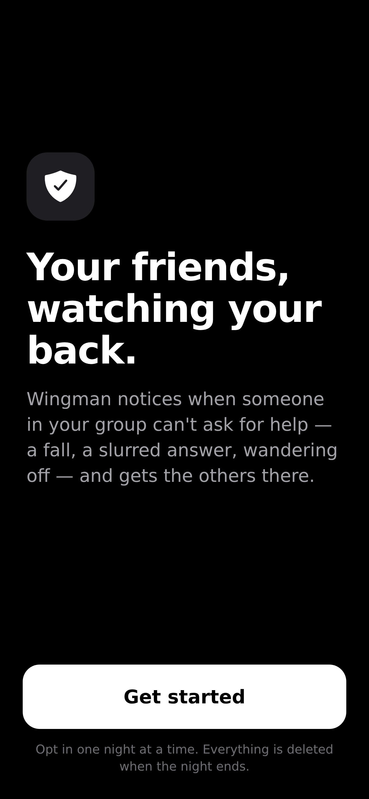
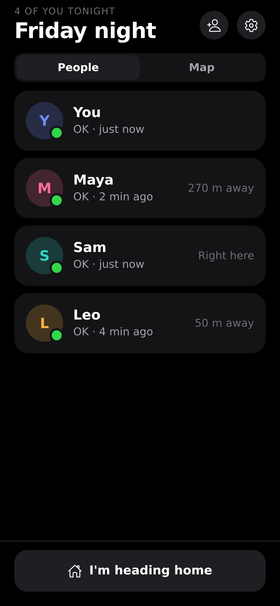
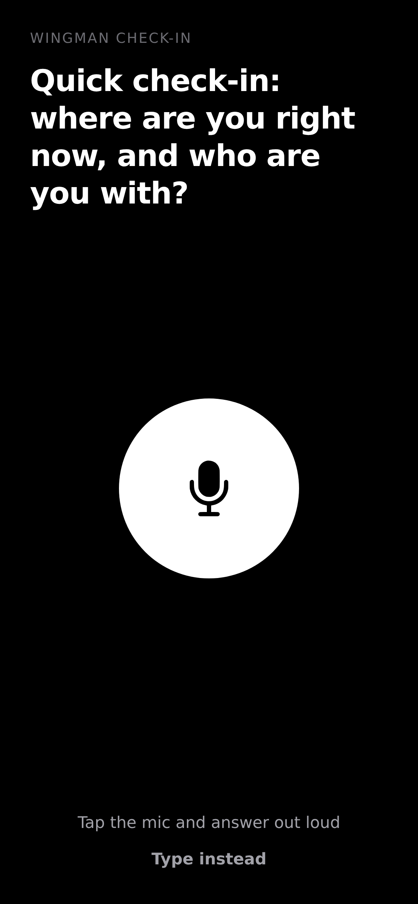
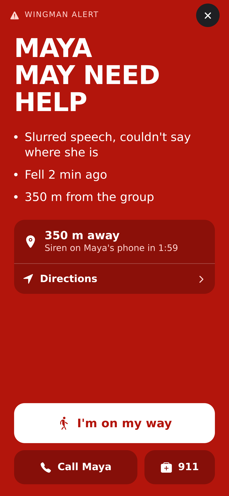
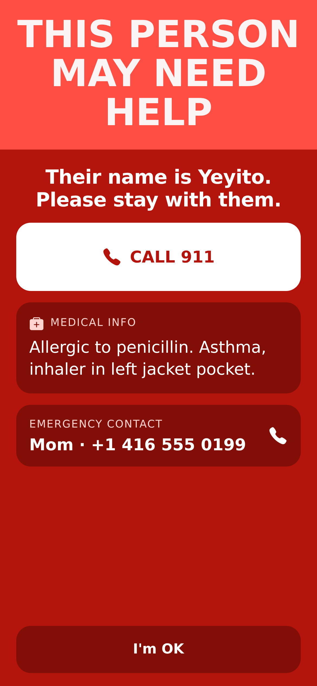

# Wingman for iPhone

The native Wingman app: Expo SDK 58, React Native, TypeScript and expo-router. Everyone in tonight's group runs it.
Everyone is guarded and everyone is a guardian, and when one person may be in trouble, all the others are alerted.

It talks to the Wingman server via the group protocol in [`../shared/protocol.ts`](../shared/protocol.ts) (docs:
[`../docs/PROTOCOL.md`](../docs/PROTOCOL.md)). Metro picks up `../shared` as a watch folder and TypeScript maps it as
`@shared/*`.

| Welcome | Group | Check-in | Friend alert | Bystander mode |
|---|---|---|---|---|
|  |  |  |  |  |

All screens are in [`docs/screenshots/`](docs/screenshots/).

## Open it on an iPhone with Expo Go (no build needed)

On whale (or any machine with Node 20+ and bun):

```bash
cd mobile
bun install
npx expo start --tunnel ngrok      # plain --tunnel needs an Expo login; "ngrok" uses an anonymous exp.direct tunnel
```

1. Install **Expo Go** from the App Store. It must be the version for SDK 58, which is the current one.
2. Scan the QR code that Expo prints using the iPhone **Camera** app, then tap the banner to open Expo Go.
   You can also type the printed `exp://…exp.direct` URL in Expo Go.
3. In the app, go to **Settings → Server** and set the Wingman server URL. It must be HTTPS and reachable from the phone,
   e.g. a `cloudflared` tunnel to the group server. The default comes from `app.json → expo.extra.serverUrl`.
   Type `mock` to use the built-in fake server (Maya, Sam and Leo). That's handy without a backend.

On the same Wi-Fi as the computer you can use `npx expo start` (LAN) instead of a tunnel.
Stop the dev server with Ctrl-C when you're done.

**Expo Go limits:** no background location, so the phone stops reporting a few seconds after the screen locks. The
server is told `appState: background` first, so this doesn't count as the phone dying. No push token either (that needs
an EAS project). Everything else works: motion and fall detection, foreground location, mic check-ins, TTS, haptics,
sounds, local notifications, QR scanning and Apple Maps.

## Native dev build (background location, the real app icon)

On the Mac with Xcode 26 and the iPhone plugged in (or on the same network with "Connect via network" enabled):

```bash
cd mobile
bun install                          # or npm install
npx expo run:ios --device            # pick the iPhone; signs with team 6BHWAL2UBU (app.json → ios.appleTeamId)
```

- Bundle id `dev.yeyito.wingman`. `ios/` is generated by prebuild (Continuous Native Generation), so don't edit it.
  Change `app.json` instead and re-run with `--clean` if native config changes.
- If signing complains, open `ios/Wingman.xcworkspace` in Xcode → target Wingman → Signing & Capabilities → Team
  *6BHWAL2UBU*, "Automatically manage signing". Then re-run the command.
- The first launch on the phone may need **Settings → General → VPN & Device Management → trust the developer**.
- `UIBackgroundModes`: `location` keeps fixes and heartbeats flowing with the screen locked (after "Always Allow").
  `audio` lets the bystander siren keep sounding when the phone locks.
- Remote push is off (`enableRemoteNotifications: false`) so signing needs no push capability. Alerts use local
  notifications plus the live socket.

## How it works

```
src/app/            screens (expo-router): onboarding, start, join, scan, group, member/[id], invite, settings
src/components/     ui kit, Overlays (CheckinSheet, AlertTakeover, Bystander), MemberMap (+ .web stub), PinPad, QrCode
src/api/client.ts   typed HTTP + WebSocket client for shared/protocol.ts (reconnect with backoff)
src/api/mock.ts     in-process fake server speaking the same protocol (server URL "mock"; used for screenshots)
src/state/          pure reducer + selectors (what takes over the screen, card status lines), tiny store + persistence
src/services/       session (server glue), sensors (location, fall detection, battery, heartbeat, app state),
                    alarm (sounds, haptics, local notifications), permissions
src/lib/fall.ts     fall detector: impact > 2.5 g, then stillness for fallConfirmMs (unit-tested)
```

- **Takeover priority:** bystander mode (you, stage ≥ 2) beats a friend's alert, which beats a check-in.
  A friend's alert stays until you tap *I'm on my way* or dismiss it. A new alert episode brings it back.
- **Check-in:** the server pushes `checkin` and the app speaks the prompt (expo-speech). It records mono AAC `.m4a`
  (expo-audio, metering), stops after 1.4 s of silence or at 8 s, and POSTs base64 audio. "Type instead" sends text.
- **Signals:** a heartbeat every 5 s with battery, app state, the latest fix and a motion summary, sent over the WS when
  it's open, otherwise over HTTP. A fall is sent immediately. `appState: background` is sent on every transition.
- **Credentials** (member id + key) live in SecureStore; the PIN does too, and it's only sent when creating or joining.
  The profile is in AsyncStorage.

## Checks

```bash
npx tsc --noEmit                                         # types
bun test                                                 # reducer, fall detector, API client (no network)
WINGMAN_URL=http://localhost:3100 bun test tests/live.test.ts   # the API client against a real group server
npx expo export --platform web --output-dir dist && bun tools/screenshots.ts   # every screen at iPhone 13 size
bun tools/keyboard.ts                                    # every text field + primary button stays above an iPhone 13 keyboard (after the export)
WINGMAN_URL=http://localhost:3100 bun tools/e2e-real.ts  # the real UI against a real server (after the export)
npx expo-doctor
```

`tools/screenshots.ts` drives the web build in headless Chromium (390×844 @3x) against the mock server, fails on JS
errors or horizontal overflow, and writes `docs/screenshots/*.png`. `tools/e2e-real.ts` serves the same build same-origin with `/api` and `/ws` proxied to a real server (it has no CORS) and
taps through join → a friend's alert → *I'm on my way* → own bystander mode → wrong PIN → right PIN → check-in → end,
writing `docs/screenshots/real/`. `tools/make-sounds.ts` regenerates the siren,
alarm and chime WAVs, and `tools/render-icon.ts` renders `assets/brand/icon.svg` into the app icon and splash.
